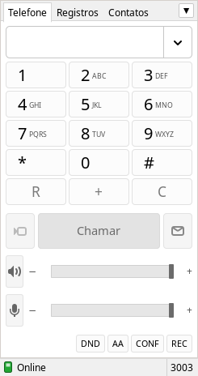

# MicruxSip

Softphone SIP para Linux com a mesma cara e o mesmo jeito de usar do MicroSIP do Windows.
Feito para quem trabalha com ramal SIP (Asterisk, Issabel, FreePBX, 3CX, Elastix...) e
migrou para o Linux mas não quer perder o discador que já conhece.

<p align="center">
   &nbsp;
  
</p>

## Recursos

- Registro em PABX SIP com autenticação (digest MD5 / SHA-256)
- Fazer e receber ligações, com janela de chamada recebida e toque
- Teclado com DTMF (RFC 2833 ou SIP INFO)
- Espera, transferência (blind transfer) e mudo
- **DND** (não perturbe), **AA** (atendimento automático), **CONF** (conferência entre as chamadas ativas) e **REC** (gravação em WAV)
- Histórico de chamadas (recebidas, feitas e perdidas) com busca
- Agenda de contatos
- Mensagens SIP (MESSAGE)
- Várias contas, alternando pelo menu
- Escolha de microfone, alto-falante e dispositivo do toque
- Atualização automática a partir deste repositório
- Abre links `sip:`, `tel:` e `callto:`

Codecs: G.711 A-law (PCMA) e u-law (PCMU). Transporte: UDP.

## Requisitos

Feito para o **Debian 13 (Trixie) com XFCE**. Deve funcionar em qualquer outra
distribuição com GTK 3 e PulseAudio ou PipeWire (Ubuntu, Mint, MX Linux, etc).

| Pacote             | Para quê                                  |
|--------------------|-------------------------------------------|
| `python3`          | o programa é em Python 3                  |
| `python3-gi`       | ligação do Python com o GTK               |
| `python3-gi-cairo` | desenho dos ícones e da interface         |
| `gir1.2-gtk-3.0`   | GTK 3                                     |
| `pulseaudio-utils` | `parec`, `pacat` e `paplay` (áudio)       |
| `libnotify-bin`    | notificação de chamada recebida (opcional)|
| `xdg-utils`        | abrir links e o arquivo de log (opcional) |

Não precisa de nenhuma biblioteca SIP externa; a pilha SIP/RTP vem junto.

## Instalação

### Jeito rápido

```sh
wget -qO- https://raw.githubusercontent.com/ezequieljc/micruxsip/main/install.sh | sh
```

### Pelo git

```sh
sudo apt install git
git clone https://github.com/ezequieljc/micruxsip.git
cd micruxsip
./install.sh
```

O instalador:

1. instala as dependências com `apt` (pede a senha do `sudo`; se o seu usuário não estiver
   no grupo sudo, pede a senha do root);
2. copia o programa para `~/.local/share/micruxsip`;
3. cria o comando `micruxsip` e o atalho no menu **Internet** do XFCE.

Tudo fica na pasta do usuário, então o programa consegue se atualizar sozinho sem pedir senha.

Para instalar as dependências na mão:

```sh
sudo apt install python3 python3-gi python3-gi-cairo gir1.2-gtk-3.0 pulseaudio-utils libnotify-bin xdg-utils
```

Também dá para rodar sem instalar: `python3 micruxsip.py`

## Primeiro uso

Na primeira vez o programa abre a tela **Conta**. Preencha pelo menos:

- **Servidor SIP**: IP ou nome do PABX (ex.: `192.168.0.10` ou `pabx.empresa.com:5060`)
- **Usuário**: o número do ramal
- **Domínio**: normalmente o mesmo IP do servidor
- **Senha**: a senha do ramal

Clique em **Salvar**. Quando a barra de baixo ficar verde com **Online**, já pode ligar.

## Atalhos

| Tecla        | Ação                         |
|--------------|------------------------------|
| `0-9 * #`    | discar / enviar DTMF         |
| `Enter`      | chamar                       |
| `Esc`        | desligar ou recusar          |
| `F2`         | atender a chamada recebida   |
| `Ctrl+M`     | editar conta                 |
| `Ctrl+P`     | configurações                |
| `Ctrl+U`     | verificar atualizações       |
| `Ctrl+Q`     | sair                         |

## Atualização

Ao abrir, o MicruxSip consulta o arquivo `VERSION` deste repositório (no máximo a cada 6 horas).
Se houver versão nova, ele pergunta se quer atualizar, baixa, troca os arquivos e reinicia.
Também dá para verificar pelo menu **▼ → Verificar Atualizações**. A verificação automática
pode ser desligada em **Configurações**.

Se o programa foi instalado com `git clone` e rodado direto da pasta, a atualização é feita
com `git pull`.

> **Para quem mantém o projeto:** para publicar uma versão, aumente o número no arquivo
> `VERSION` (ex.: `1.0.0` → `1.0.1`) e faça o push na branch `main`.

## Onde ficam os arquivos

| Caminho                       | Conteúdo                                         |
|-------------------------------|--------------------------------------------------|
| `~/.local/share/micruxsip/`   | o programa                                       |
| `~/.config/micruxsip/`        | contas, contatos, histórico e log (`micruxsip.log`) |
| `~/Gravações MicruxSip/`      | gravações (pode mudar em Configurações)          |

A senha do ramal fica salva em `~/.config/micruxsip/config.json`, com permissão só para o seu usuário.

## Problemas comuns

**Fica em "Registrando..." ou dá erro**
Confira se o PC alcança o PABX (`ping IP_DO_PABX`), se usuário, domínio e senha estão certos e
olhe o log em **▼ → Ver Arquivo de Log**. Erro `403` normalmente é senha errada ou ramal sem
permissão para aquele IP.

**Liga mas não tem áudio, ou só um lado escuta**
Normalmente é firewall ou NAT. Libere UDP `5060` (SIP) e `4000-4999` (áudio). Com `ufw`:

```sh
sudo ufw allow 5060/udp
sudo ufw allow 4000:4999/udp
```

Se o PABX estiver fora da rede (nuvem), deixe marcado **Permitir reescrever IP** na conta.

**O outro lado escuta eco**
Use fone de ouvido. O programa não tem cancelamento de eco próprio.

**O microfone não pega**
Em **Configurações → Microfone**, escolha o dispositivo certo. Confira também o volume de
entrada no `pavucontrol`.

**A porta 5060 já está em uso**
Se outro softphone estiver aberto, o MicruxSip usa uma porta livre automaticamente. Também dá
para fixar outra porta em Configurações.

## Limitações

- Só UDP (sem TCP/TLS) e sem SRTP
- Só G.711 (PCMA/PCMU), sem G.729, G.722 ou Opus
- Sem vídeo
- Transferência só direta (sem transferência assistida)

## Desinstalar

```sh
~/.local/share/micruxsip/uninstall.sh          # mantém contas e histórico
~/.local/share/micruxsip/uninstall.sh --purge  # apaga tudo
```

## Testes

Há um PABX falso para testar sem servidor de verdade. Ele registra dois ramais e testa
ligação, áudio, espera, gravação, mensagem, cancelamento e recusa:

```sh
python3 tests/test_calls.py
```

## Estrutura

```
micruxsip.py   interface (GTK 3)
sipcore.py     pilha SIP/RTP, codecs G.711 e mixer de áudio
updater.py     atualização pelo GitHub
install.sh     instalador
uninstall.sh   desinstalador
data/          ícone
tests/         PABX falso e teste de ponta a ponta
```

## Licença

MIT. Veja [LICENSE](LICENSE).

O MicruxSip é um projeto independente. A interface é inspirada no MicroSIP para Windows,
mas não tem relação com os autores dele.
